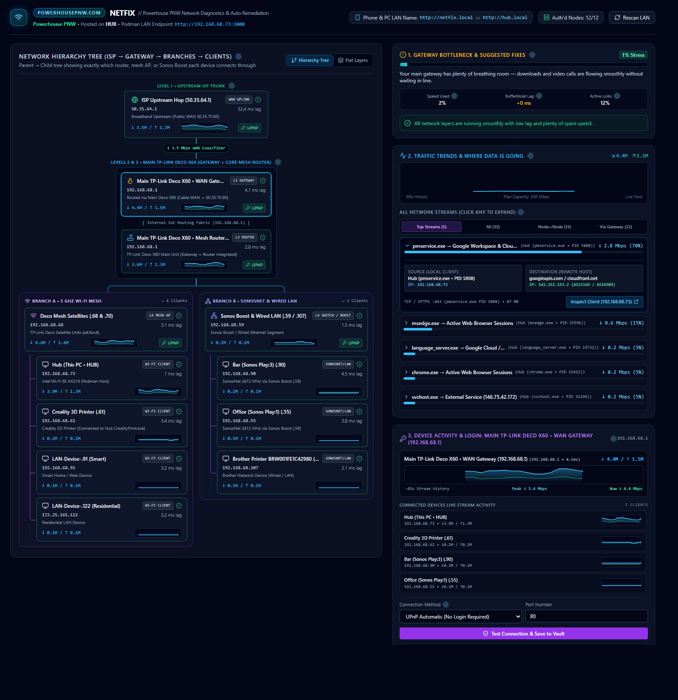

# Netfix — Powerhouse PNW Network Diagnostics & Topology Hub

[](https://powerhousepnw.com)


**Netfix** is a self-hosted, real-time residential & prosumer network topology, stream telemetry, and automated bottleneck remediation platform engineered for **[powerhousepnw.com](https://powerhousepnw.com)**.

Designed to run continuously inside a local **Podman** container on your home server (`Hub`) with zero cloud dependencies, Netfix discovers your upstream ISP trunk, main WAN gateway, mesh satellites, SonosNet wireless matrix, and connected client devices—giving both desktop and mobile phone users on your Wi-Fi an instant, plain-English X-ray of where bandwidth is going and why lag happens.



---

## ✨ Key Capabilities

### 1. Branching Parent → Child Network Hierarchy Tree
Unlike flat device scanners that dump every IP into a single list, Netfix maps the actual physical and wireless parent-child hierarchy of your network:
- **Level 1 • Upstream ISP Trunk**: Auto-discovered via Traceroute Hop #2 and UPnP IGD External WAN IP queries.
- **Levels 2 & 3 • Main WAN Gateway & Core Mesh Router**: Tracks your primary router (e.g., TP-Link Deco X60 at `192.168.68.1`) across both its WAN NAT boundary and internal SoC routing fabric.
- **Level 4 • Distribution Branches**: Automatically separates traffic into parallel distribution branches:
  - **Branch A • 5 GHz Wi-Fi Mesh** (Deco Mesh Satellite APs)
  - **Branch B • SonosNet 2412 MHz & Wired LAN** (Sonos Boost / Managed Switch segment discovered via UPnP `ZoneGroupTopology`)
- **Level 5 • Connected Clients with Live Sparklines**: Every device hangs directly underneath the distribution branch it communicates through, complete with a live dual-series SVG stream activity line graph (`↓ Mbps` download in sky-blue, `↑ Mbps` upload in emerald).

### 2. Gateway Bottleneck & Bufferbloat Engine
Your home gateway is the single choke point for all internet traffic. Netfix computes a live **0–100% Gateway Stress Score** every 3 seconds by combining:
- **WAN Bandwidth Saturation (45% weight)**: Live download/upload throughput vs. plan capacity via UPnP `WANCommonInterfaceConfig` byte counters.
- **Bufferbloat Queue Lag (40% weight)**: Real-time ICMP ping delta under load compared against your idle baseline latency.
- **NAT Connection Table & Packet Loss (15% weight)**: Tracks active socket pressure and dropped packets, surfacing 1-click automated fixes (CAKE SQM / QoS traffic prioritization, Double-NAT bridge detection, and Wi-Fi channel optimization).

### 3. Deep Stream Inspection (`Top Streams` • `All` • `Node↔Node` • `Via Gateway`)
- **Top Streams**: Groups active connections by application process and destination service/ASN, showing exact session megabytes transferred and share of total bandwidth.
- **Node ↔ Node (Local LAN)**: Surfaces east-west traffic inside your house—such as 3D printer slicing transfers (`CrealityPrint.exe`), SonosNet audio group streams, and 5 GHz mesh backhaul links.
- **Via Gateway (Outbound WAN)**: Lists every active outbound socket routing through `192.168.68.1` with process name, PID, source/target IP:port, and 1-click client inspection.

### 4. Built for Desktop & Mobile Companion (`http://netfix.local`)
- **Desktop View (`>= 1024px`)**: Two-column layout pairing the interactive **Network Hierarchy Tree** on the left with a 3-card **Live Inspector Sidebar** on the right.
- **Mobile Companion (`< 1024px`)**: Touch-optimized 4-tab bottom navigation bar (**Map**, **Traffic**, **Fixes**, **Devices**) with a sticky Gateway Bottleneck header bar.
- **Zero-Config LAN Naming**: Includes a lightweight host-side mDNS (`UDP 5353`) + LLMNR (`UDP 5355`) responder and TCP proxy (`scripts/lan-proxy.mjs`) so phones, tablets, and laptops on your Wi-Fi can open **`http://netfix.local`** or **`http://hub.local`** directly.

---

## 🔒 Local-Only Security & Credential Vault

Netfix is built with a strict **zero-secrets-in-repo** architecture:
- All optional hardware login credentials (`SNMP v2c/v3`, `SSH`, `HTTP API`, `UPnP`) are encrypted at rest using **AES-256-GCM** (`src/lib/crypto/vault.ts`) before being written to the local SQLite database (`/data/netfix.db` inside the persistent `netfix_data` Podman volume).
- The 256-bit master encryption key is generated outside the repository at **`%LOCALAPPDATA%\Netfix\master.key`** and injected into the container at runtime via `--env-file %LOCALAPPDATA%\Netfix\netfix.env`.
- API endpoints (`/api/snapshot`, `/api/credentials`) **never** return plaintext secrets—only masked summaries (` CredentialSummary`).

---

## 🚀 Quick Start & Auto-Start on Reboot

### Provision or Update the Podman Container
From an elevated PowerShell prompt on your host machine (`Hub`):

```powershell
powershell -ExecutionPolicy Bypass -File scripts/provision-podman.ps1
```

This script:
1. Ensures the Podman machine is running and generates your local-only `%LOCALAPPDATA%\Netfix\master.key` if not already present.
2. Builds `localhost/netfix:latest` from `Containerfile` and starts `netfix-hub` with `--restart=always` and the persistent `netfix_data` volume.
3. Configures Windows Firewall rules for LAN access and launches `scripts/lan-proxy.mjs` so `http://netfix.local` is immediately reachable from any phone or PC on your network.

### Automatic Startup on Windows Reboot
To ensure Netfix starts automatically every time the PC reboots (even before logging in), register the startup task pointing to `scripts/start-netfix.ps1`:

```powershell
powershell -ExecutionPolicy Bypass -File scripts/start-netfix.ps1
```

---

## 🧪 Development & Testing

Run the unit and integration test suite (covering AES-256-GCM encryption, SQLite persistence, bottleneck scoring, hardware adapters, and API routes) with **Vitest**:

```bash
npx vitest run
npm run build
```
